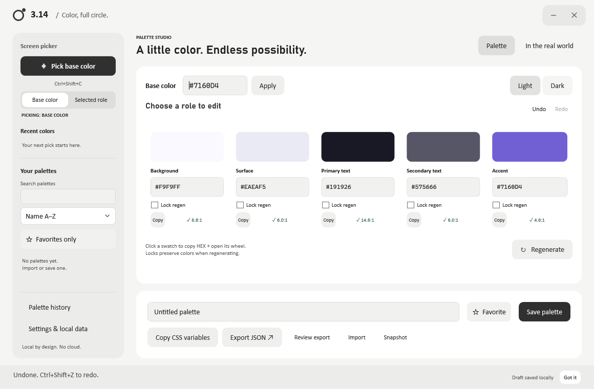

# 3.14 — Color Picker & Palette Studio

**Pi. Color, full circle.** Local Windows workflow: pick → generate → preview → export. The circle references the color wheel and workflow. π does not mathematically improve palettes. Name availability/trademark clearance have not been checked.



A native Windows color tool: freeze your screen, pick a pixel, build a semantic website palette, check individual contrast pairs, and export CSS or JSON. All color generation and saved data stay on your computer.

- **Real desktop sampling:** configurable global shortcut, frozen capture, magnifier, keyboard sampling and clipboard copy.
- **Palette editing:** five semantic roles, light/dark variants, locks, undo/redo, HSV wheel and RGB/HSL/OKLCH input.
- **Useful output:** live interface preview, pair-specific contrast checks, named CSS variables and versioned JSON.
- **Local library:** named palettes, favorites, recent colors, snapshots, backup and validated recovery.

[Build and run](#start-and-build) · [Usage](#pick-and-edit) · [Data and recovery](#settings-and-recovery) · [Tests](#verification) · [Limitations](#capture-limits) · [Architecture](#architecture-and-artifacts)

## Start and build

Windows 10 1703+ or Windows 11, x64, .NET Framework 4.8. No downloaded dependencies, API keys, accounts or services.

```powershell
./build.ps1
./dist/3.14.exe
```

**Get a build:** open the repository’s [Windows build workflow](https://github.com/marmalade1124/3.14/actions/workflows/windows-build.yml), select a successful run and download its portable artifact (GitHub sign-in may be required), or build locally with the commands above. No signed installer or published release is claimed.

The portable executable is `dist/3.14.exe`. It is unsigned. Close quits and unregisters the shortcut. The window is **fixed at 1160 × 760 logical units**. Manual resizing, maximizing and double-click maximizing are disabled, superseding the earlier maximize/Snap and adaptive-sizing suggestions. Drag the title area to move. Custom minimize/close controls remain, and right-clicking the title area or Alt+Space opens the Windows system menu. Resize/maximize options are disabled. Very high display scaling on a small monitor can leave insufficient logical workspace for this fixed window.

## Pick and edit

Use Pick or **Ctrl+Shift+C** while the app is running. Choose **Base** to sample a seed and generate a palette. Choose a role and **Selected role** to replace only that role. Field focus does not silently change the target. The target is named on the button, sidebar and frozen-screen magnifier.

The app/editors hide before all monitors are captured; overlays appear only after capture. Click or Enter samples and copies HEX. Escape cancels without changing the clipboard. Arrows move one physical pixel. Monitor-configuration changes cancel. Screenshots remain in memory and are disposed after selection, cancellation or capture failure.

Click a swatch to copy HEX and open its editor; the separate **Copy** action copies without opening it. Nearby Copied feedback and a polite accessibility announcement confirm success. Selected roles have a charcoal frame and EDITING badge.

The contained editor previews live. **Apply** commits one undo step. **Cancel**, Escape and the backdrop restore the opening color. Brightness **Reset** restores opening brightness while preserving current hue/saturation. Arrows on the wheel adjust hue/saturation; Tab reaches remaining controls. Advanced input supports RGB, HSL and OKLCH numbers, with validation. Out-of-sRGB OKLCH reduces chroma at constant lightness/hue and shows a gamut notice. Expanding Advanced keeps the editor inside the window.

**Lock regen** preserves colors during generation or variant changes; explicit edits still work. Locks are not silently released for contrast. The initial accent exactly matches the seed. Deterministic OKLCH tone generation and hue variation need no AI. It does not promise universally accessible or objectively better palettes.

## Undo, saving and library

Undo/Redo buttons and **Ctrl+Z**, **Ctrl+Shift+Z** or **Ctrl+Y** cover palette/library changes; an entire wheel session is one step. Native text-field undo is retained. Undo keeps up to 50 steps for this session.

The footer distinguishes Draft saved locally, Saved palette, saving failure and disabled saving. Named palettes require Save palette; replacing a name asks first. Drafts, palettes, favorites, recent colors, shortcut and snapshots persist. Five recent colors are shown; 24 are retained.

**Snapshot** stores the current palette name and time. **Palette history** shows the last 20 generated/saved snapshots. Opening one is undoable and does not overwrite a saved palette. Library search, newest/name sorting and favorites help navigation. The ⋯ menu supports Rename, Duplicate and Delete; deletion is undoable. Long libraries use the custom scrollbar. Main pages do not scroll.

## Preview and export

Palette and **In the real world** are separate screens. Heading/body/card/button/input preview refreshes from current palette values on navigation. The sample button has no navigation. Editor controls use app-theme colors, independently of generated values.

Per-role issue badges open full contrast checks. WCAG relative sRGB luminance ratios: normal text AA 4.5:1; large text 3:1 (18 pt regular / 14 pt bold); essential non-text boundaries 3:1. Primary/secondary text are checked against background/surface, accent/background gets a non-text check, and button label/accent gets its own check. PASS applies only to the stated pair and threshold, not the entire palette.

Copy CSS, export JSON, or **Review export** to inspect exact CSS/JSON output before copy/save. Import accepts version-1 palette JSON and earlier unversioned app exports. Missing/invalid roles and unsupported versions are rejected before state changes; name collisions create a distinct palette.

## Settings and recovery

**Settings & local data** provides shortcut recording, import, backup/restore and quick help. The workspace is light-only, with neutral gray surfaces and charcoal actions. Legacy Dark/System preferences migrate safely to Light; generated palettes still offer light/dark variants. Windows High Contrast takes priority: custom UI resources use system colors. Mouse focus stays quiet; keyboard cues remain subtle. Motion respects Windows' client-animation preference. Fonts use installed Bahnschrift/Calibri/Cascadia Mono with Segoe UI/Consolas fallbacks; nothing is downloaded.

Record a modifier plus A–Z or F1–F24. Invalid/reserved/occupied combinations show an error and restore the old registration. Escape abandons recording. The shortcut works only while the app runs. The first-use hint is dismissible and can be reopened in Settings.

Storage: `%LOCALAPPDATA%\3.14\library.json`. New optional fields retain compatibility with original version-1 libraries. Saves validate JSON, flush a temporary file and atomically replace the library; `library.json.bak` retains the prior revision. Invalid libraries disable writes and preserve original bytes; current work can still be exported.

**Back up library** exports the full dataset. **Restore library** validates first, asks before replacement, and archives the existing file as `library.json.recovery-<timestamp>` before saving. It works with a damaged current library. Invalid input leaves the original untouched. If a backup shortcut is unavailable, the prior working shortcut is retained. Keep original/recovery copies until you confirm the restored data.

## Verification

```powershell
Start-Process ./dist/3.14.exe -ArgumentList '--self-test' -Wait
Get-Content ./test-results.txt
Start-Process ./dist/3.14.exe -ArgumentList '--feature-test' -Wait
Get-Content ./feature-results.txt
# Requires an idle, unobstructed interactive desktop:
Start-Process ./dist/3.14.exe -ArgumentList '--integration-test' -Wait
Get-Content ./integration-results.txt
```

Verified: **621 core assertions and 27 feature assertions**, including OKLCH references/round trips/gamut mapping, formats/imports, contrast/locks, legacy storage, damaged-data recovery, cancellation/undo, fixed dimensions, light-only appearance migration, library tools, snapshots, restore and export review. Feature tests use fresh `.test-data/integration-<run>.json` files. Light UI/settings/contained-editor renders were inspected; these are app renders, not saved screen captures.

The full desktop test injects real input, uses a known-color native window, captures the desktop and exercises clipboard/hotkeys/cancellation. It temporarily raises only its test window. Run it without concurrent mouse/keyboard use. Cursor and prior text clipboard content are restored; other clipboard formats are not. The latest full run is **not a pass**: native hit testing at the wheel point identified a browser renderer intercepting pointer input. The failure is logged rather than counted as success.

Physical multi-monitor/mixed-DPI, negative origins, HDR/protected/elevated-screen configurations, Windows High Contrast switching and screen-reader behavior remain unverified. File dialogs and native shortcut recording need an unobstructed interactive desktop check.

## Capture limits

- Per-display physical rectangles and PerMonitorV2 support negative-coordinate/mixed-DPI architecture; real hardware still needs checking.
- Output is 8-bit SDR sRGB HEX. HDR, wide gamut, profiles and compositor tone mapping can differ from source/perceived colors. No HDR fidelity is promised.
- Protected/DRM/capture-excluded content may be black or unavailable. Protection is not bypassed.
- UAC secure desktop, sign-in, lock screens and other sessions cannot be sampled. Do not elevate to try to bypass that boundary.
- Elevated apps on the ordinary desktop may be visible, but overlay focus/input across privileges are not guaranteed. Remote desktop and unusual GPUs are untested.
- Displays capture sequentially; moving content can differ slightly across them. Composition flush and a 120 ms wait follow hiding the app.

## Architecture and artifacts

No external dependencies. WPF supplies UI/accessibility, WinForms device-pixel overlays, Win32 hotkeys/monitor coordinates, and GDI real capture. `Palette.cs`/`ColorFormats.cs` own color logic, `Store.cs` validated atomic storage, `Picker.cs` capture lifetime, and partial `Studio` files the UI/local tools. `build.ps1` uses the .NET Framework compiler bundled with Windows.

See `IMPLEMENTATION-CHECKLIST.md` for all requested UX items and overrides, `LOGO-PROMPT.md` for the requested minimal-logo prompt, and `graphify-out/` for source mapping. No logo has been generated. Curated notes live in the shared Knowledge vault. No accounts, cloud, analytics, subscriptions, payments or licensing infrastructure.

References: [W3C CSS Color 4](https://www.w3.org/TR/css-color-4/) and [Microsoft contrast themes](https://learn.microsoft.com/en-us/windows/apps/design/accessibility/high-contrast-themes). The chroma-reduction mapper is this app's deterministic implementation; it does not claim the full CSS gamut-mapping specification.

Dialogs are centered in a non-layout overlay with a visible neutral outline. Palette history offers Clear history, which persists immediately and can be undone with Ctrl+Z after closing the dialog; saved palettes and recent sampled colors are preserved. Windows 11 native rounded corners are requested through DWM; older systems keep their native shape.


## Repository layout

```text
Main.xaml               WPF layout, shared styles and typography
src/Studio*.cs          Desktop workflow, editing and library tools
src/Picker.cs          In-memory frozen-screen overlays
src/Native.cs          Win32 capture, monitors and global shortcut
src/Palette.cs         Semantic roles, generation, contrast and export
src/ColorFormats.cs    OKLCH conversion, gamut mapping and input formats
src/Store.cs           Validated local storage and atomic replacement
src/Tests.cs           Core, feature and native desktop checks
website/               Companion website (when present)
.github/workflows/     Windows build and portable artifact
```

## Development

Edit C# or XAML, close any running copy of 3.14, rebuild, then run the relevant checks above. The build script needs Windows and the .NET Framework 4.8 compiler/reference assemblies; if PowerShell blocks a downloaded script, review it before using a process-scoped execution-policy override. No NuGet restore or Node installation is needed for the desktop app. CI runs core assertions; interactive desktop tests are a separate local check.

Source is published for review and personal development. No open-source license or trademark clearance is asserted. Do not infer redistribution rights from the repository being visible.

## Companion website

The matching light-only website is in [`website/dist`](website/dist), with setup and behavior in [`website/README.md`](website/README.md). It uses plain HTML/CSS/JavaScript and system fonts, with no installation or bundler. Serve it locally:

```powershell
python -m http.server 4173 --directory website/dist --bind 127.0.0.1
```

Open http://127.0.0.1:4173. Four prepared sample palettes demonstrate a live card, specific text/background contrast and CSS copying; the browser demo does not perform native screen picking. Clipboard failure offers selectable output. Local preview, palette selection, keyboard activation, copy feedback, FAQ and narrow layout have been checked. Screen-reader testing and real mobile-device testing remain outstanding.
